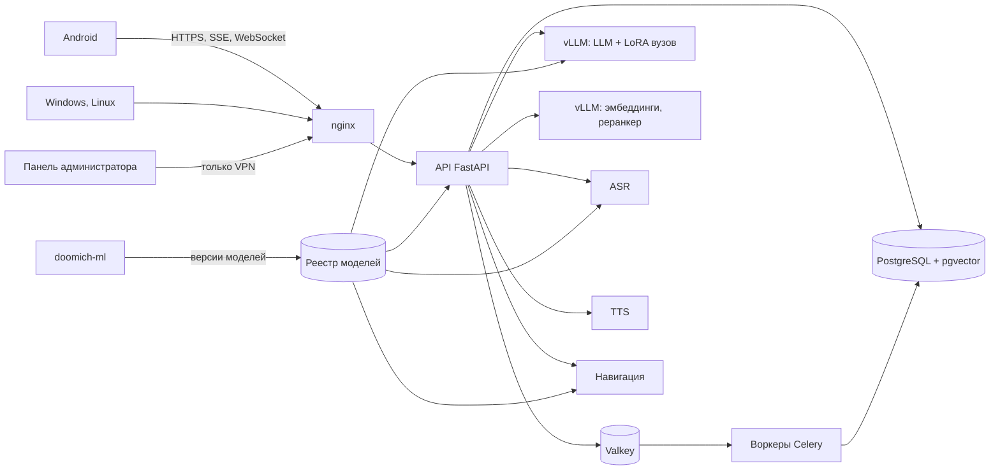

# Документация разработчика

Как устроен код «Думыча», как его запускать, собирать, развёртывать и как обучать модели под вузы.
Проектные решения и план — в [`docs/`](../README.md).

| Документ | О чём |
|---|---|
| [Локальная разработка](local.md) | Python-сервер, панель администратора, клиенты, стенд в Docker, тесты |
| [Клиенты Android, Windows и Linux](clients.md) | Рабочее пространство Flutter, сборки, подпись, особенности платформ |
| [Развёртывание и эксплуатация](deploy.md) | Сервер, Docker Compose, HTTPS, модели, резервные копии, мониторинг, обновления |
| [Модели под вузы и кампусы](ml-training.md) | ML-платформа `doomich-ml`: данные, обучение, пороги качества, реестр |
| [Граф кампуса](campus-graph.md) | Формат графа для навигации и как его готовить |

## Устройство репозитория

```
apps/
  client/              Flutter: общее ядро и два приложения
    packages/doomich_core   API, модели, SSE, голосовой протокол (чистый Dart)
    packages/doomich_ui     экраны, состояние (Riverpod), локализация RU/EN
    mobile/                 Android
    desktop/                Windows и Linux
  admin/               панель администратора (React, TypeScript, Ant Design)
services/
  api/                 сервер: FastAPI, PostgreSQL + pgvector, Celery, миграции Alembic
  asr/                 распознавание речи (GigaAM, Whisper, модели вузов из реестра)
  tts/                 синтез речи (sherpa-onnx), нормализация текста RU/EN
  nav/                 «Где я?» по фото: дескриптор ONNX + индекс кампуса
libs/common/           общее для Python: реестр моделей, работа со звуком
ml/                    ML-платформа: обучение моделей под вуз и кампус
infra/                 Docker, compose, nginx, мониторинг, Ansible, скрипты
docs/                  план проекта и документация
```

## Как части связаны



Данные вузов разделены построчной защитой PostgreSQL (RLS): API подключается ролью без прав
суперпользователя и для каждого запроса задаёт пользователя и вуз. Переписка и файлы пользователей
шифруются ключом пользователя, который в свою очередь зашифрован мастер-ключом сервера.
